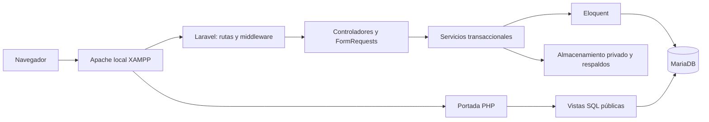
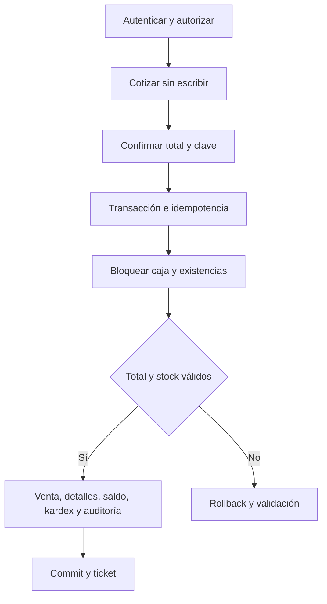
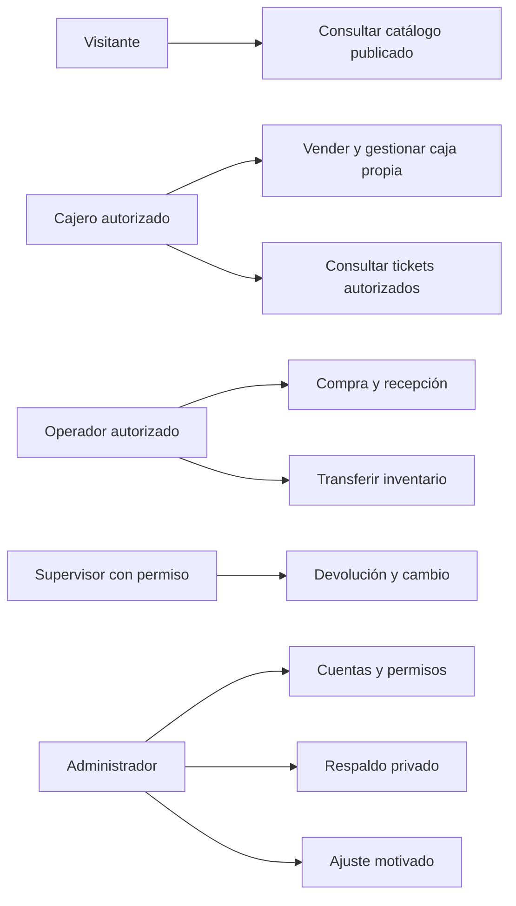

# Diagramas de la implementación

Metadatos físicos extraídos del esquema desplegado; las relaciones son claves foráneas reales, no inferencias.

```mermaid
erDiagram
    almacenes {
        int id PK
        varchar nombre
        varchar ubicacion
        tinyint activo
    }
    auditoria_cambios {
        int id_auditoria PK
        int id_venta_original
        int id_venta_nueva
        int id_cambio
        int id_cliente
        enum tipo_operacion
        decimal monto_original
        decimal monto_nuevo
        decimal saldo_generado
        text observacion
        datetime fecha_auditoria
    }
    ventas ||--o{ auditoria_cambios : FK
    cambios_ventas ||--o{ auditoria_cambios : FK
    clientes ||--o{ auditoria_cambios : FK
    auditoria_operaciones {
        bigint id PK
        int id_usuario
        varchar accion
        varchar entidad
        varchar referencia
        text cambios
        timestamp created_at
    }
    cambios_ventas {
        int id_cambio PK
        int id_venta_original
        int id_venta_nueva
        int id_cliente
        enum tipo
        decimal monto_saldo
        enum estado
        text observacion
        timestamp fecha_cambio
        int id_usuario
    }
    ventas ||--o{ cambios_ventas : FK
    ventas ||--o{ cambios_ventas : FK
    clientes ||--o{ cambios_ventas : FK
    categorias {
        bigint id_categoria PK
        varchar nombre
        tinyint activo
        tinyint publicado
        varchar slug
    }
    clientes {
        int id_cliente PK
        varchar nombre_cliente
        varchar documento_identidad
        varchar telefono
        varchar email
        text direccion
        tinyint activo
        int sellos
        int total_compras
        int tarjetas_llenas
    }
    compras {
        int id_compra PK
        int id_proveedor
        int id_almacen
        int id_usuario
        timestamp fecha_compra
        decimal total_compra
        timestamp fecha_recepcion
        enum estado
        int id_moneda
        varchar moneda_codigo
        decimal tipo_cambio_aplicado
    }
    almacenes ||--o{ compras : FK
    proveedores ||--o{ compras : FK
    usuarios ||--o{ compras : FK
    detalles_cambio {
        int id_detalle PK
        int id_cambio
        int id_producto
        int cantidad
        decimal precio
        enum tipo
        bigint id_detalle_venta
        int id_servicio
    }
    cambios_ventas ||--o{ detalles_cambio : FK
    cambios_ventas ||--o{ detalles_cambio : FK
    productos ||--o{ detalles_cambio : FK
    detalle_compras {
        int id_detalle_compra PK
        int id_compra
        int id_producto
        int cantidad
        decimal costo_unitario
    }
    compras ||--o{ detalle_compras : FK
    productos ||--o{ detalle_compras : FK
    detalle_servicio {
        int id_servicio_realizado PK
        int id_servicio
        int id_cliente
        decimal cantidad
        decimal precio_total
        datetime fecha
        enum estado
    }
    servicios ||--o{ detalle_servicio : FK
    clientes ||--o{ detalle_servicio : FK
    detalle_transferencias {
        bigint id PK
        bigint id_transferencia
        int id_producto
        int cantidad
    }
    transferencias ||--o{ detalle_transferencias : FK
    detalle_ventas {
        bigint id_detalle_venta PK
        int id_venta
        int id_producto
        int id_servicio
        varchar tipo_item
        int cantidad
        decimal precio_unitario
        decimal descuento
        int id_almacen
        decimal costo_unitario_base
        decimal importe_neto
    }
    servicios ||--o{ detalle_ventas : FK
    ventas ||--o{ detalle_ventas : FK
    productos ||--o{ detalle_ventas : FK
    existencias {
        bigint id PK
        int id_producto
        int id_almacen
        int stock
        int saldo_inicial
        timestamp created_at
    }
    almacenes ||--o{ existencias : FK
    productos ||--o{ existencias : FK
    migrations {
        int id PK
        varchar migration
        int batch
    }
    movimientos_caja {
        int id_movimiento_caja PK
        int id_turno
        int id_usuario
        enum tipo_movimiento
        decimal monto
        varchar descripcion
        timestamp fecha
        int referencia_id
    }
    turnos_caja ||--o{ movimientos_caja : FK
    usuarios ||--o{ movimientos_caja : FK
    movimientos_inventario {
        int id_movimiento PK
        int id_producto
        int id_almacen
        enum tipo_movimiento
        int cantidad
        int stock_anterior
        int stock_nuevo
        timestamp fecha
        int id_usuario
        int referencia_id
    }
    almacenes ||--o{ movimientos_inventario : FK
    productos ||--o{ movimientos_inventario : FK
    usuarios ||--o{ movimientos_inventario : FK
    movimiento_servicio {
        int id_movimiento_servicio PK
        int id_servicio_realizado
        enum tipo_movimiento
        decimal monto
        datetime fecha
        text descripcion
    }
    detalle_servicio ||--o{ movimiento_servicio : FK
    operaciones {
        bigint id PK
        int id_usuario
        varchar accion
        varchar clave
        varchar huella
        text respuesta
        timestamp created_at
    }
    permisos {
        int id_permiso PK
        varchar nombre_permiso
        varchar descripcion
    }
    productos {
        int id_producto PK
        varchar codigo_barra
        varchar nombre
        text descripcion
        bigint id_categoria
        int id_almacen
        int id_proveedor_preferido
        decimal precio_compra
        decimal precio_venta
        int stock
        int stock_minimo
        tinyint activo
        timestamp fecha_creacion
        timestamp fecha_actualizacion
        varchar imagen_path
        varchar imagen_url
        tinyint publicado
        varchar slug
    }
    almacenes ||--o{ productos : FK
    categorias ||--o{ productos : FK
    proveedores ||--o{ productos : FK
    proveedores {
        int id_proveedor PK
        varchar nombre_proveedor
        varchar ruc
        varchar telefono
        varchar email
        text direccion
        tinyint activo
    }
    roles {
        int id_rol PK
        varchar nombre_rol
    }
    rol_permiso {
        int id_rol PK
        int id_permiso PK
    }
    roles ||--o{ rol_permiso : FK
    permisos ||--o{ rol_permiso : FK
    saldos_clientes {
        int id_saldo PK
        int id_cliente
        decimal saldo
        timestamp fecha_actualizacion
        enum estado
        int id_moneda
    }
    clientes ||--o{ saldos_clientes : FK
    servicios {
        int id_servicio PK
        varchar nombre
        text descripcion
        decimal precio_venta
        tinyint activo
        timestamp fecha_creacion
        timestamp fecha_actualizacion
    }
    tipo_cambio {
        date fecha PK
        int id_moneda PK
        varchar tipo_moneda
        decimal valor_soles
    }
    tipo_moneda ||--o{ tipo_cambio : FK
    tipo_moneda {
        int id PK
        varchar descripcion
        varchar simbolo
        tinyint activo
        varchar codigo
        tinyint principal
    }
    transferencias {
        bigint id PK
        int id_usuario
        int origen
        int destino
        varchar estado
        timestamp created_at
        timestamp updated_at
    }
    turnos_caja {
        int id_turno PK
        int id_usuario
        timestamp fecha_apertura
        decimal monto_inicial
        timestamp fecha_cierre
        decimal monto_final_sistema
        decimal monto_final_real
        decimal diferencia
        enum estado
        int num_ventas
        decimal total_ingresos
        decimal efectivo
        decimal yape
        decimal agora
        decimal plin
        decimal transferencia
        decimal total_bruto
        decimal total_neto
        decimal ganancia
    }
    usuarios {
        int id_usuario PK
        varchar nombre_completo
        varchar username
        varchar password
        int id_rol
        varchar moneda
        tinyint activo
        timestamp fecha_creacion
    }
    roles ||--o{ usuarios : FK
    ventas {
        int id_venta PK
        int id_cliente
        int id_usuario
        int id_turno
        int id_caja
        timestamp fecha_venta
        decimal total_venta
        decimal descuento_sellos
        decimal descuento_manual
        varchar metodo_pago
        varchar observacion
        varchar estado
        int numero_cliente
        tinyint es_cambio
        int id_moneda
        varchar moneda_codigo
        decimal tipo_cambio_aplicado
        decimal total_base
        decimal saldo_utilizado
        decimal cobro_base
    }
    clientes ||--o{ ventas : FK
    turnos_caja ||--o{ ventas : FK
    usuarios ||--o{ ventas : FK
    ventas_anuladas {
        int id_anulacion PK
        int id_venta_original
        int id_cliente
        decimal monto_reembolsado
        text motivo
        int id_cambio
        datetime fecha_anulacion
    }
    ventas ||--o{ ventas_anuladas : FK
    cambios_ventas ||--o{ ventas_anuladas : FK
    clientes ||--o{ ventas_anuladas : FK
```

## Componentes y despliegue

## Actividad de venta

## Casos de uso

Los actores requieren permisos concretos por operación; no se crea una nueva jerarquía de roles con estos nombres descriptivos.
