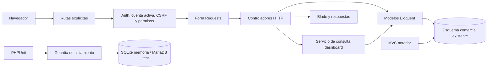

> Antecedente histórico: el estado vigente está en [INFORME_FINAL.md](../INFORME_FINAL.md). Las referencias a migración pendiente o MVC activo describen una etapa anterior.

# Fase 0 — reestructuración arquitectónica

Fecha: 13/11/2026. **Estado: iniciada, base técnica validada; migración completa pendiente.**

## Orden vigente

0. Arquitectura Laravel y refactorización.
1. Backend y base de datos.
2. Sistema administrativo.
3. Sitio público.
4. Auditoría integral y validación final.

La auditoría anterior es la línea base. No se avanzó a fases posteriores como si la arquitectura estuviera cerrada. La exportación confirmó **26 tablas**, corrigiendo el conteo de 27 del informe anterior.

## Diagnóstico y antipatrones

El proyecto original es MVC PHP propio: 18 controladores, 19 modelos, 32 vistas y 108 declaraciones públicas. No contiene Laravel. SQL en controladores, MySQLi global, superglobales, require relativos y redirecciones con exit acoplan HTTP, negocio y persistencia. Venta y Caja concentran responsabilidades; reportes/estados se repiten; rutas y credenciales estaban codificadas. No había suite propia ni migraciones.

Hashes iniciales registrados en baseline.json local e ignorado por Git. Los errores comerciales previamente identificados no se consideran corregidos por crear modelos nuevos.

## Trabajo realizado

- Laravel 12.72.0 aislado en laravel/, compatible con PHP 8.2.12. Se conserva punto de entrada y vendor del MVC.
- Lock independiente y plataforma Composer PHP 8.2.12. No se actualizó XAMPP.
- 25 modelos Eloquent para las 26 tablas; rol_permiso es pivote. PK españolas, relaciones, decimales y timestamps existentes explícitos. TipoCambio es de lectura por PK compuesta, sin inventar id.
- Auth nativo con username/hash existente; regeneración de sesión, logout, cuenta activa, CSRF y limitación de intentos. No hay registro público ni rehash automático en la BD comercial.
- Gates/policy consultan permisos reales sin snapshot en sesión ni bypass implícito. Categorías utiliza categorias_ver_lista y categorias_crear_editar.
- Controllers delgados, Requests y Blade; resumen DashboardQuery inyectado por container. Primer flujo de categorías: listado/alta/edición validada, con escrituras bloqueadas por defecto en negocio.
- .env ignorado, APP_READ_ONLY=true, sesión/cache en archivos y colas sync. Sin tablas auxiliares de infraestructura innecesarias.
- Configuración del MVC extraída a config/local.php ignorado y config/connection.php; admite STUDIO_DB_HOST/USER/PASS/NAME. Mismos valores de conexión; plantilla sin credenciales en local.example.php.
- .htaccess protectores para configuración, respaldos, logs, herramientas, documentación, vendor y libs. Laravel solo se sirve bajo public/.
- Esquema exportado sin datos. Baseline de migración solo para pruebas: DDL real MariaDB y fixture SQLite. Guardias en comandos, repositorio y migración impiden crear incluso migrations en negocio.
- PHPUnit, Pint y Larastan configurados. Prueba arquitectónica rechaza superglobales, MySQLi, require_once y header/exit en app/ nuevo.

No se crearon repositorios/interfaces/eventos/colas por entidad. No hay adaptador que ejecute controladores antiguos ni ruta comodín que salte middleware.

## Estructura y responsabilidades

```text
mi_sistema_mvc/
  app/, public/, config/, vendor/     MVC actual en transición
  config/connection.php             configuración compatible sin secretos
  config/local.php                  privado e ignorado
  docs/phase-0/                     plan, informe, inventario, resultados
  tools/                            Composer y comprobaciones
  laravel/
    app/Console/Commands/           chequeo de esquema de lectura
    app/Http/Controllers/           Auth, Dashboard, Categorias
    app/Http/Requests/              validación y autorización de entrada
    app/Http/Middleware/            cuenta activa y bloqueo de escritura
    app/Models/                     25 entidades del esquema existente
    app/Policies/                   autorización de categorías
    app/Providers/                  integración con container y Gates
    app/Services/Dashboard/         consultas reutilizables
    app/Support/Database/           protección de migraciones
    bootstrap/, config/, routes/    estructura Laravel
    database/schema/               DDL/metadatos sin datos personales
    database/migrations/           baseline exclusivo de pruebas
    resources/views/               Blade
    public/                        único directorio público de Laravel
    storage/                       archivos privados y runtime
    tests/                         arquitectura, HTTP, modelos, migraciones
```



Coexistencia transitoria: no es la arquitectura final de dos administradores independientes.

## Matriz SOLID

| Principio | Aplicación verificable | Límite |
|---|---|---|
| S | Requests validan, policy autoriza, controller responde, modelos relacionan, servicio resume | Monolitos antiguos pendientes |
| O | Rutas/policies/container permiten agregar módulos sin router dinámico global | Sin abstracciones anticipadas |
| L | Contratos Laravel; repositorio de migraciones conserva firmas | Precondición de seguridad transitoria explícita; revisar al definir despliegue definitivo |
| I | Sin interfaces generales artificiales | Contratos adicionales solo si aportan valor real |
| D | DashboardQuery inyectado por container, providers nativos | CRUD simple usa Eloquent directamente; no se presume independencia absoluta del ORM |

## Dependencias

Nuevo lock: Laravel y dependencias de producción; PHPUnit, Mockery, Collision, Pint y Larastan/PHPStan para desarrollo. Se retiraron Pail, Sail, Tinker y Faker del esqueleto porque no se usan. Sin NPM/Vite para estas primeras vistas Blade/CSS local. No se alteraron los exportadores del MVC.

Manifest/lock nuevos válidos. Composer informó ausencia de avisos de vulnerabilidades durante la resolución; no certifica seguridad del negocio. Laravel 12 permite conservar PHP 8.2, pero requiere planificar actualización antes de terminar su soporte de seguridad en febrero de 2027.

## Pruebas y análisis

| Comprobación | Resultado |
|---|---|
| CLI | Laravel 12.72.0 |
| Esquema activo desde Laravel | 26 tablas coinciden por nombres de tablas/columnas; sin escritura |
| PHPUnit SQLite | 19 pruebas, 246 aserciones satisfactorias |
| PHPUnit MariaDB | 19 pruebas, 246 aserciones satisfactorias en BD única _test; driver exigido en pruebas |
| Migraciones | Crear, rollback y crear otra vez en ambos motores aislados |
| Guardia | Rechazo fuera de testing antes de crear migrations; tienda_sistema rechazado incluso en testing |
| Larastan nivel 5 | Sin errores en app/ nuevo; no incluye MVC antiguo |
| Pint | Formato comprobado/corregido |
| Composer validate --strict | Válido |
| HTTP actual | Login anterior y catálogo público: 200 |
| HTTP Laravel | auth/login y up: 200; logo accesible |
| HTTP privado | config/database.php, backups/, logs/debug.log, laravel/.env y laravel/vendor/autoload.php: 403 |

Casos: login/hash sin escritura, inactivo, logout, permisos revocados, CSRF real, intentos limitados, categorías sin permiso, alta/edición, duplicado/blanco/array, campos adicionales rechazados, modo de lectura, escapado HTML, consultas de todas las relaciones y fixtures de venta/producto. Datos sintéticos exclusivos de pruebas, nunca catálogo real.

JUnit: tests-sqlite.xml y tests-mariadb.xml. Se corrigieron errores intermedios de caché, configuración de pruebas y middleware. La prueba de seguridad detectó que proteger solo up() no bastaba y motivó proteger también el repositorio. No se deshabilitaron pruebas para aprobar.

No se realizó venta/devolución/cierre real ni recorrido visual de las 16 vistas. HTTP 200 no acredita funcionamiento integral. El baseline es para pruebas, no una migración de producción.

## Registro de archivos y refactorización

Inventario entregado: FILES.md. Dependencias, .env, config/local.php, cachés y baseline local no se versionan. Código original modificado: config/database.php ahora lee configuración privada con los mismos valores. Se añadieron .htaccess; logs/debug.log recibió entradas normales de consultas HTTP, sin edición manual.

Del esqueleto nuevo se retiraron User.php/UserFactory, migraciones users/cache/jobs, welcome, ExampleTest, comando inspire, package.json, Vite y recursos sin consumidores. Se sustituyeron por entidades existentes y pruebas útiles. No se eliminaron funciones comerciales del MVC. Scripts generadores de una ejecución se retiraron para evitar sobrescrituras posteriores.

## Pendientes para cerrar Fase 0

1. Trasladar por responsabilidades ventas, cambios/devoluciones, compras, inventario, transferencias y caja. No copiar monolitos dentro de Services ni ocultarlos detrás de un puente.
2. Completar maestros, usuarios, reportes, PDF/Excel y contratos AJAX, con caracterización de comportamiento antes de modificar reglas.
3. Completar dashboard/categorías: gráficos, estados y acciones existentes aún no están todos trasladados. Los primeros componentes nuevos no sustituyen las 16 vistas.
4. Extraer duplicación de reportes, fidelización, saldos, imágenes y backups, delimitando transacciones. Errores comerciales preexistentes siguen abiertos.
5. Verificar compatibilidad de URLs/contratos y adaptar consumidores cuando cambie un método HTTP por seguridad.
6. Sustituir progresivamente vistas/llamadas y centralizar hardcodes restantes. Sesiones PHP y Laravel son independientes.
7. Regresión completa antes del cambio de punto de entrada; solo después retirar MVC y evaluar mover Laravel a raíz. No se cambió DocumentRoot.

Por estos pendientes, **Fase 0 no está cerrada**: no se declara eliminación completa de antipatrones o compatibilidad funcional integral.

## Operación y reversión

Continuar usando la URL administrativa actual. Mantener APP_READ_ONLY=true en Laravel conectado a tienda_sistema. Conservar config/local.php al desplegar o usar STUDIO_DB_*; nunca subirlo a Git. No ejecutar migrate/fresh/refresh/reset/wipe en negocio: la guardia complementa permisos mínimos y backups.

No se programaron tareas ni servicios; puertos, credenciales del servidor, Apache y php.ini se conservaron. El rollback de aplicación no necesita rollback de datos porque no hubo cutover ni modificación de registros comerciales. Las protecciones HTTP deben conservarse.

Las bases studio_phase0_*_test creadas por tools/test-mariadb.php se conservan para inspección, con esquema/fixtures de prueba y sin datos copiados de negocio.

## Referencias oficiales

- [Estructura Laravel](https://laravel.com/docs/12.x/structure).
- [Middleware](https://laravel.com/docs/12.x/middleware).
- [Compatibilidad y soporte](https://laravel.com/docs/12.x/releases).
- [Despliegue y directorio public](https://laravel.com/docs/12.x/deployment).
